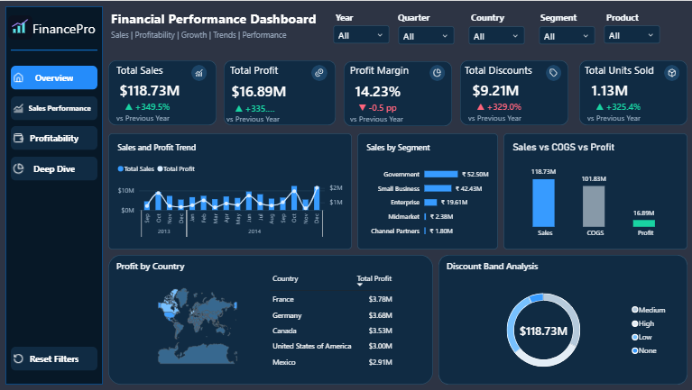

# Financial Performance & Profitability Intelligence | FinancePro

**Power BI portfolio project** using Microsoft's Financial Sample workbook (educational sample data, not client work).

## Project overview
A single-page interactive financial overview built in Power BI Desktop. It combines sales, profit, profitability, discounts, units sold, time trends, segment contribution, a country-profit map and a discount-band donut chart in a dark FinancePro design.

## Tools and workflow
- **Power BI Desktop:** interactive dashboard, slicers and visualization
- **Power Query:** data import, preparation and type handling (transformations are embedded in the PBIX)
- **DAX:** financial measures and time intelligence
- **Excel:** Microsoft Financial Sample source data

## Dataset and KPIs
The sample contains **700 financial observations** covering **September 2013–December 2014**. The dashboard displays approximately **118.73M sales**, **16.89M profit**, **14.23% profit margin**, **9.21M discounts** and **1.13M units sold**.

The dashboard uses a `$` display symbol; the source workbook does not explicitly establish a currency, so this should be understood as a display convention, not verified transaction currency.

## Dashboard features
- Five KPI cards with previous-year comparisons
- Monthly sales and profit trend
- Sales by business segment
- Sales vs COGS vs Profit comparison
- Profit by country (world shape map and ranking)
- Discount-band donut (sales distribution by band; center shows total sales)
- Year, quarter, country, segment and product slicers

## Open the project
1. Open [`dashboard/Financial_Performance_Dashboard.pbix`](dashboard/Financial_Performance_Dashboard.pbix) in Power BI Desktop.
2. If prompted about a missing local source, update the Excel file path in **Transform data > Data source settings** to [`data/Financial Sample.xlsx`](data/Financial%20Sample.xlsx), then refresh.
3. Inspect the Overview report page and test slicers.

## Repository contents
- `dashboard/`: Power BI report file
- `data/`: source Excel workbook
- `screenshots/`: report preview
- `dax/`: **original draft/reference DAX files**, not a verified complete export of the final PBIX model
- `documentation/`: data dictionary and QA checklist
- `assets/branding/`: original logo SVG

## Important limitations
- Educational/synthetic data; no client work or live business data.
- 2013 includes only Sep–Dec, while 2014 includes Jan–Dec. Full-year YoY comparisons against 2013 are **not like-for-like**; KPI growth values require matched-period verification before external claims.
- Profit is source-defined Sales minus COGS, **not accounting net income**.
- The map uses a custom world shape; geographic color matching should be checked before interpreting the shading.
- Discount-band donut slices represent **sales by discount band**, not discount expense. The center total is sales.
- This repository documents the **single Overview page**, not the four-page expansion in the original planning blueprint.

## Status
Dashboard design complete. Final DAX synchronization, date-comparison QA, and interaction testing are pending; see [`documentation/QA_CHECKLIST.md`](documentation/QA_CHECKLIST.md).
